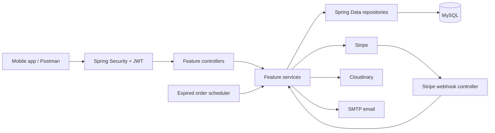
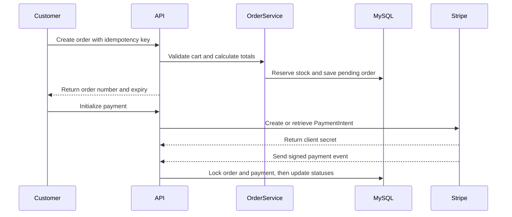

# PriceTag Backend

PriceTag Backend is the REST API for the PriceTag commerce application. It uses Java 21, Spring Boot 4.1.1, Spring MVC, Spring Security, Spring Data JPA, and MySQL. The mobile client is maintained separately in `../PriceTag_Mobile`.

## Capabilities

### Accounts and access

- Registration, email OTP verification, login, JWT access tokens, refresh tokens, logout, and password recovery
- User profile and address management
- Role-aware authorization through Spring Security

### Shopping and catalog

- Product and category/subcategory catalog, variant/color/size data, search and paginated listing
- Product/category media through Cloudinary-backed media services
- Customer cart operations and product ratings/reviews

### Orders and payments

- Checkout calculates prices on the server, snapshots shipping details, reserves variant stock, and records order status history
- `Idempotency-Key` prevents duplicate orders on retry; it must be a UUID, and reusing a key with different request details is rejected
- Stripe PaymentIntent initialization, signed webhook verification, and synchronized order/payment status updates
- Pending orders can be cancelled or expire automatically; lifecycle handling releases the cart and restores reserved stock once
- Expiry scheduler defaults to a 60-second interval and 100 orders per batch. Configure `orders.expiration.check-delay-ms` and `orders.expiration.batch-size`.

## Architecture

The application is organized as a feature-oriented monolith. HTTP controllers validate and accept requests, services coordinate business rules and transactions, repositories access persistence, and mappers convert entities to API DTOs. Entities remain behind the API boundary.



### Source layout

```text
src/main/java/com/example/pricetag/
├── features/
│   ├── auth/          # Registration, OTP, JWT and refresh tokens
│   ├── user/          # User profile and account operations
│   ├── address/       # Saved customer addresses
│   ├── product/       # Product catalog and product details
│   ├── category/      # Categories and category media
│   ├── subcategory/   # Category subdivisions
│   ├── Variant/       # Variant, color, and size catalog (legacy casing)
│   ├── cart/          # Cart and cart item lifecycle
│   ├── order/         # Checkout, order lifecycle, history, expiry scheduler
│   ├── payment/       # Payment records, PaymentIntent, Stripe webhooks
│   ├── media/         # Media assets and product/category attachments
│   ├── cloudinary/    # Cloudinary integration
│   ├── ratingReview/  # Product ratings and reviews
│   └── sample/        # Sample feature module
├── config/            # Application, security, API documentation configuration
├── exceptions/        # Shared exception types and API error handling
├── dto/, enums/       # Shared response DTOs and domain enums
└── utils/             # Shared helpers
src/test/java/         # Unit and integration tests, mirroring production packages
src/main/resources/    # Default, dev, and prod Spring configuration
postman/               # Versioned Postman collection and environment
```

Typical feature modules contain `controller`, `service`, `repository`, `entity`, `dto`, and `mapper` packages. The `Variant` package retains legacy uppercase casing; use lowercase for new package names.

### Checkout lifecycle



Cancellation and scheduled expiry share lifecycle rules: succeeded payments cannot be cancelled, Stripe intents are cancelled when applicable, and stock/cart state is restored consistently. The scheduler processes each expired order independently.

## Run locally

Requirements: Java 21 and Docker Compose, or a local MySQL server. Create a root `.env` file with local values; do not commit credentials.

```dotenv
MYSQL_LOCAL_DATABASE=pricetag
MYSQL_LOCAL_PASSWORD=choose-a-local-password
JWT_SECRET=replace-with-a-long-random-secret
EMAIL_HOST=smtp.example.com
EMAIL_PORT=587
EMAIL_USERNAME=your-email-username
EMAIL_PASSWORD=your-email-password
CLOUDINARY_CLOUD_NAME=your-cloud-name
CLOUDINARY_API_KEY=your-cloudinary-api-key
CLOUDINARY_API_SECRET=your-cloudinary-api-secret
STRIPE_PUBLISHABLE_KEY=your-stripe-publishable-key
STRIPE_SECRET_KEY=your-stripe-secret-key
STRIPE_WEBHOOK_SECRET=your-stripe-webhook-secret
```

Run the API and database in Docker:

```bash
docker compose up --build
```

The API is at `http://localhost:8000`; MySQL is exposed at port `3307`. For IDE/Maven use, start MySQL at `localhost:3306` and run:

```bash
./mvnw spring-boot:run
```

The API then listens at `http://localhost:8080`. The `dev` profile supports `MYSQL_LOCAL_PORT`, `MYSQL_LOCAL_DATABASE`, `MYSQL_LOCAL_USER`, and `MYSQL_LOCAL_PASSWORD`. The server port can be set with `PORT`.

## API reference and Postman

Swagger UI is available at `/swagger-ui/index.html`; OpenAPI JSON is at `/v3/api-docs`. Most routes use `/api/v1`. Protected operations require a bearer access token; use Swagger to inspect endpoint-specific authorization and request schemas.

The Postman collection and workspace binding are versioned in `postman/` and `.postman/`. Set the local environment's `baseUrl` to `http://localhost:8000` for Docker or `http://localhost:8080` for IDE/Maven, then provide authentication and service values. Access and refresh tokens are stored as empty environment variables and should only be populated locally.

## Tests and build

```bash
./mvnw test -DskipTests=false
./mvnw clean package -DskipTests=false
```

Tests use JUnit/Mockito and H2 test configuration where applicable. Maven skips tests by default, so include `-DskipTests=false` to run them.

## Configuration and deployment

The default profile is `dev`; the `prod` profile reads deployment-specific database settings, including Railway TCP proxy variables. Environment configuration covers MySQL, JWT, SMTP, Cloudinary, and Stripe. Do not commit `.env`, credentials, or webhook secrets. Hibernate schema updates are enabled in the current profiles; review the production schema migration strategy before deployment.

## Contributing

Keep controllers thin, inject dependencies through constructors, use request/response DTOs rather than returning entities, and follow existing feature conventions. Preserve transaction and locking behavior in inventory, checkout, order expiry, and Stripe webhook code. Add tests for behavior changes and keep API examples/collection updates aligned with contract changes.

## License

No `LICENSE` file is currently included.
